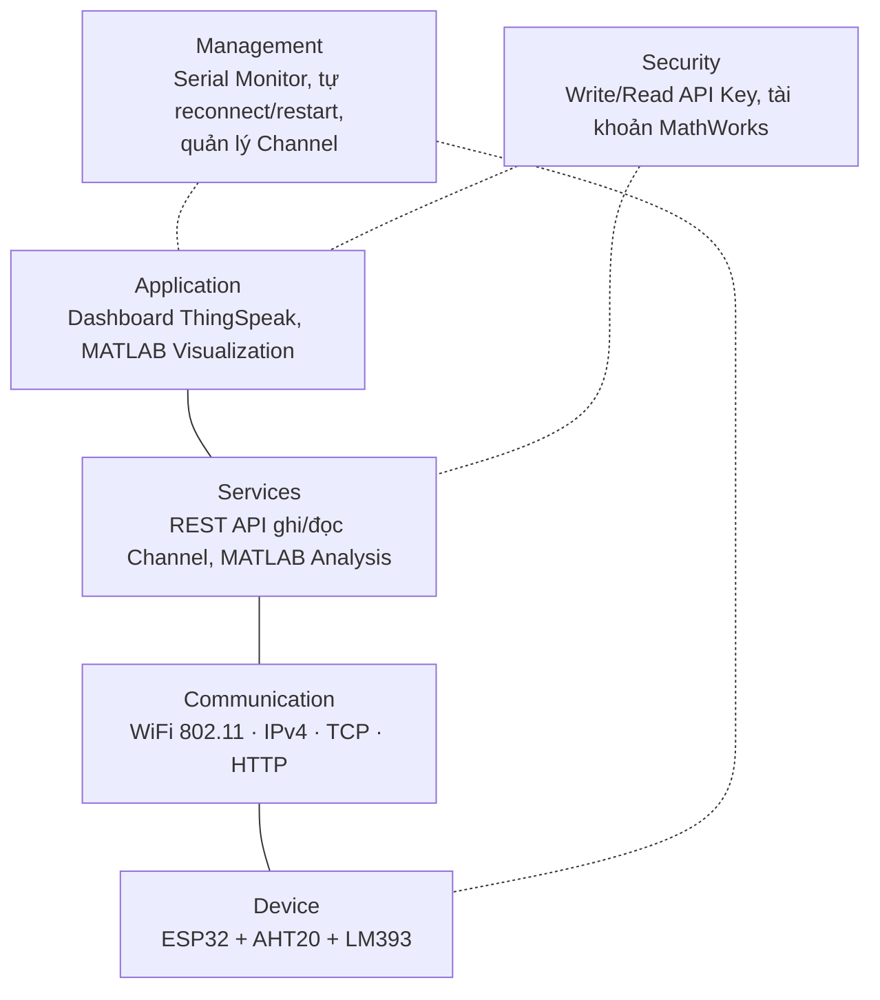
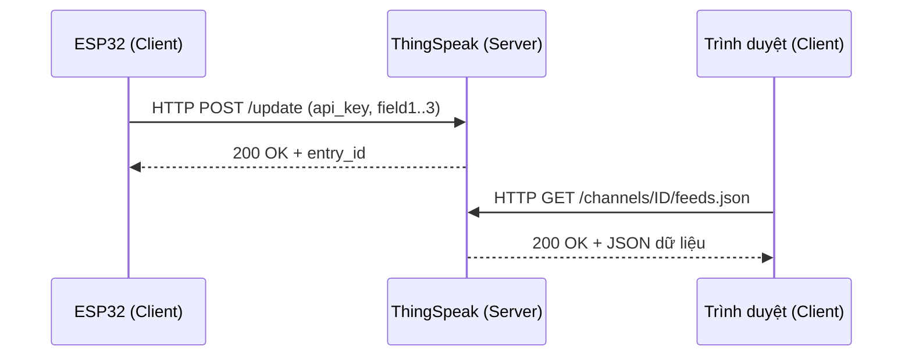
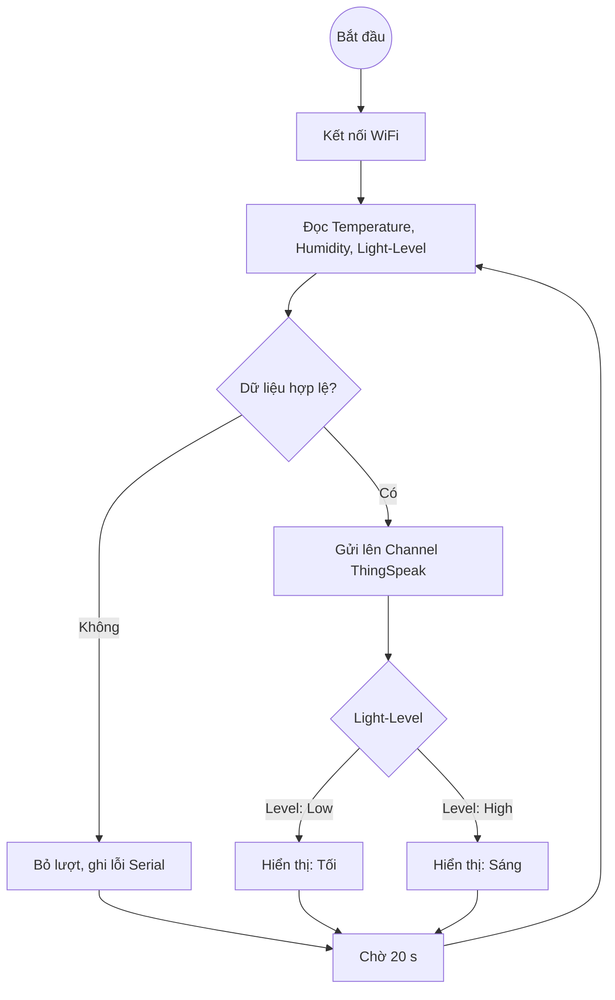
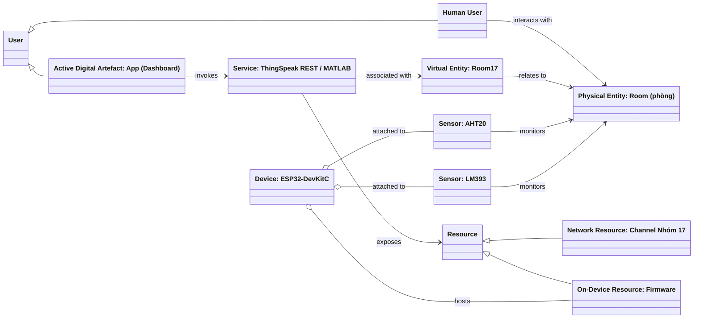
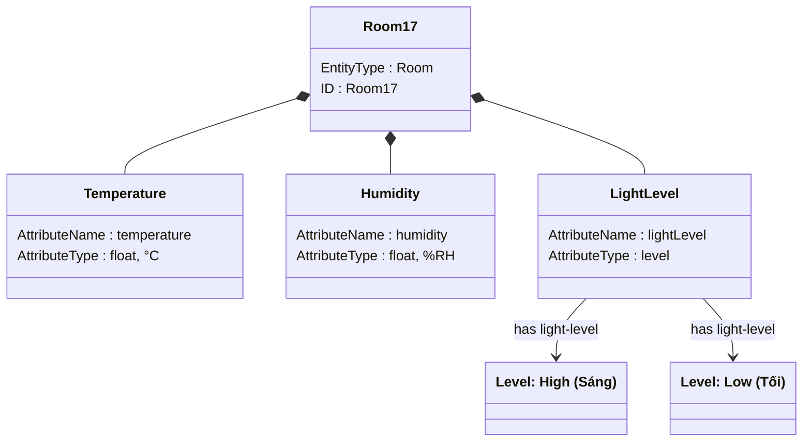
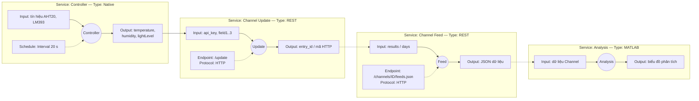
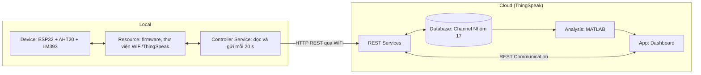
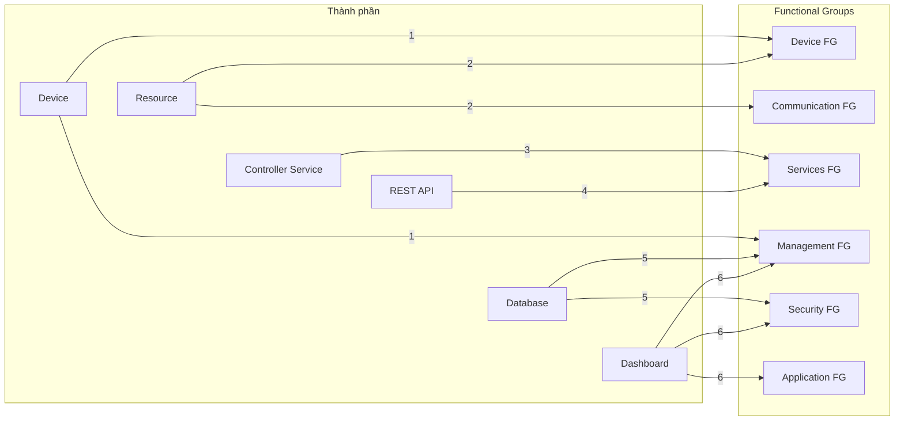
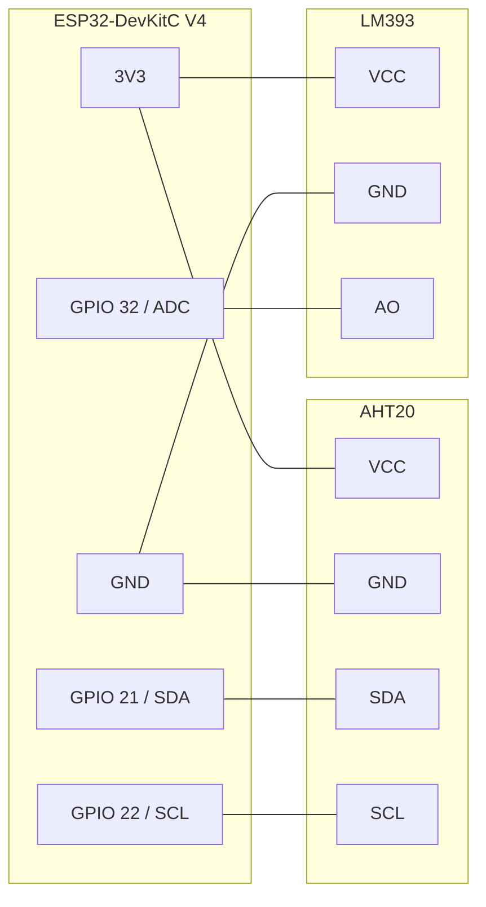
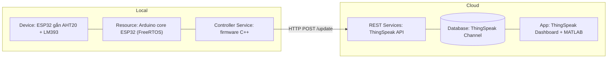

# BÁO CÁO BÀI TẬP LỚN GIỮA KỲ — MÔN IoT VÀ ỨNG DỤNG

**Học viện Công nghệ Bưu chính Viễn thông**  
**Giảng viên:** TS. Nguyễn Đức Minh  
**Nhóm:** 17  
**Đề tài:** Hệ thống giám sát nhiệt độ, độ ẩm và ánh sáng trong phòng dùng ESP32 và ThingSpeak

| Thành viên | MSSV | Nhiệm vụ |
|---|---|---|
| | | |
| | | |
| | | |

> Các sơ đồ trong báo cáo viết bằng Mermaid (hiển thị trên GitHub, VS Code có extension *Markdown Preview
> Mermaid Support*). Cần ảnh để dán vào Word: dán từng khối vào <https://mermaid.live> → *Export PNG*.

---

## Mục lục
- [Phần I. Giới thiệu đề tài](#phần-i-giới-thiệu-đề-tài)
- [Phần II. Cơ sở lý thuyết áp dụng (Chương 1)](#phần-ii-cơ-sở-lý-thuyết-áp-dụng-chương-1)
- [Phần III. Thiết kế hệ thống theo phương pháp 10 bước (Chương 3)](#phần-iii-thiết-kế-hệ-thống-theo-phương-pháp-10-bước-chương-3)
- [Phần IV. Tích hợp toàn bộ hệ thống](#phần-iv-tích-hợp-toàn-bộ-hệ-thống)
- [Phần V. Thực nghiệm, kiểm thử và đánh giá](#phần-v-thực-nghiệm-kiểm-thử-và-đánh-giá)
- [Phần VI. Kết luận](#phần-vi-kết-luận)
- [Tài liệu tham khảo](#tài-liệu-tham-khảo)

---

# Phần I. Giới thiệu đề tài

## 1. Yêu cầu đề bài
Xây dựng ứng dụng IoT đơn giản thu thập dữ liệu từ **2 cảm biến bất kỳ** dùng **ESP32**, hiển thị trực quan
dữ liệu trên web dưới nhiều dạng đồ thị (plot, bar, chart, ...), có thể dùng nền tảng IoT như ThingSpeak,
Firebase. Báo cáo trình bày theo **phương pháp thiết kế 10 bước** của Chương 3.

## 2. Giải pháp của nhóm
| Mục | Lựa chọn |
|---|---|
| Thiết bị | ESP32-DevKitC V4 (ESP32-WROOM-32, WiFi 802.11 b/g/n 2.4 GHz) |
| Cảm biến 1 | **AHT20** — nhiệt độ + độ ẩm, giao tiếp I2C (SDA GPIO 21, SCL GPIO 22) |
| Cảm biến 2 | **LM393** (module quang trở) — cường độ ánh sáng, ngõ ra analog AO |
| Nền tảng IoT | **ThingSpeak** (MathWorks): lưu trữ, REST API, đồ thị, MATLAB Analysis |
| Lập trình | Arduino IDE 2.x, C++ (Arduino core for ESP32) |
| Chu kỳ gửi | 20 giây (ThingSpeak free cho phép tối thiểu 15 giây/lần) |
| ThingSpeak Channel | `<điền Channel ID>` — Field 1 Nhiệt độ, Field 2 Độ ẩm, Field 3 Ánh sáng |

---

# Phần II. Cơ sở lý thuyết áp dụng (Chương 1)

## 1. Khái niệm IoT áp dụng vào đề tài
Theo Bahga & Madisetti, IoT là hạ tầng mạng toàn cầu, trong đó các “things” vật lý và ảo có danh tính, có
thuộc tính vật lý và tính cách ảo, được tích hợp liền mạch vào mạng thông tin. Trong đề tài:
- **Vật vật lý:** căn phòng cần giám sát; **vật ảo:** Channel `<điền Channel ID>` trên ThingSpeak đại diện cho căn phòng.
- **Danh tính:** địa chỉ IP do router cấp cho ESP32, Channel ID và URI REST của ThingSpeak.

## 2. Các đặc điểm IoT thể hiện trong hệ thống
| Đặc điểm (mục 1.3) | Thể hiện trong hệ thống |
|---|---|
| Dynamic & Self-Adapting | Tự kết nối lại khi mất WiFi; bỏ qua lượt đo lỗi, không gửi dữ liệu rác |
| Self-Configuring | Tự quét WiFi khi khởi động; mất mạng quá lâu (5 vòng ~3 phút) tự khởi động lại |
| Interoperable Communication Protocols | Dùng giao thức chuẩn WiFi 802.11, IPv4, TCP, HTTP |
| Unique Identity | IP của ESP32, Channel ID + URI REST của ThingSpeak |
| Integrated into Information Network | Dữ liệu đưa lên cloud, xem từ mọi thiết bị có trình duyệt |

## 3. Thiết kế vật lý (mục 1.4)
**Thiết bị IoT** — ESP32 thực hiện chức năng *Sensing* và *Monitoring*, gửi dữ liệu lên back-end cloud để xử lý.

| Giao diện thiết bị (mục 1.4.2) | Hiện thực |
|---|---|
| I/O cho cảm biến | I2C (SDA GPIO 21, SCL GPIO 22, địa chỉ 0x38) cho AHT20; ADC 12-bit (GPIO 32) cho LM393 |
| Internet Connectivity | WiFi 2.4 GHz tích hợp trên ESP32 |
| Memory & Storage | Flash 4 MB chứa firmware, RAM 520 KB |
| Audio & Video | Không sử dụng |

| Lớp giao thức (mục 1.4.4) | Giao thức sử dụng |
|---|---|
| Link | IEEE 802.11 (WiFi) |
| Network / Internet | IPv4 |
| Transport | TCP |
| Application | HTTP (REST API của ThingSpeak) |

*Lý do chọn HTTP thay vì MQTT:* dữ liệu gửi định kỳ 20 s, khối lượng nhỏ, không cần nhận lệnh tức thời; HTTP
REST được ThingSpeak hỗ trợ trực tiếp qua thư viện chính thức, đơn giản khi triển khai.

## 4. Thiết kế logic (mục 1.5)

## 5. Mô hình trao đổi thông tin (mục 1.6)
Hệ thống dùng **REST API** trên mô hình **Request–Response**:

## 6. Thành phần và cấp độ IoT (mục 1.7)
| Thành phần (mục 1.7.1) | Trong hệ thống |
|---|---|
| Device | ESP32-DevKitC V4 gắn AHT20 và LM393 |
| Resource | Firmware Arduino trên ESP32: đọc cảm biến, thư viện WiFi + ThingSpeak để truy cập mạng |
| Controller Service | Vòng lặp chính của firmware: đọc cảm biến và gửi dữ liệu lên dịch vụ web mỗi 20 s |
| Database | Channel `<điền Channel ID>` trên cloud ThingSpeak |
| Web Service | ThingSpeak REST API (HTTP) |
| Analysis Component | MATLAB Visualization trên ThingSpeak |
| Application | Dashboard ThingSpeak (Private View / Public View) |

**Cấp độ IoT: Level 3** (mục 1.7.4) — *một node duy nhất*; *dữ liệu lưu trữ trên đám mây*; *phân tích thực
hiện trên đám mây*; *ứng dụng dựa trên đám mây*. Hệ thống không phải Level 1 (không lưu/phân tích trên thiết
bị) và không phải Level 2 (phân tích không thực hiện cục bộ).

---

# Phần III. Thiết kế hệ thống theo phương pháp 10 bước (Chương 3)

## Bước 1. Đặc tả mục đích và yêu cầu (Purpose & Requirements Specification)
| Hạng mục | Đặc tả |
|---|---|
| **Mục đích** | Hệ thống giám sát môi trường trong phòng, cho phép xem nhiệt độ, độ ẩm, ánh sáng từ xa qua ứng dụng web |
| **Hành vi** | Thiết bị đo định kỳ mỗi 20 s và gửi lên cloud; web hiển thị giá trị hiện tại, lịch sử và kết quả phân tích; ánh sáng được phân mức *Sáng / Tối* theo ngưỡng |
| **Yêu cầu thu thập dữ liệu** | Nhiệt độ (°C), độ ẩm (%RH), mức ánh sáng (0–4095); loại bỏ lượt đo lỗi |
| **Yêu cầu phân tích dữ liệu** | Phân tích trên cloud: min/trung bình/max theo giờ, phân bố (histogram), tương quan nhiệt độ–độ ẩm, nhiệt độ cảm nhận |
| **Yêu cầu quản lý hệ thống** | Giám sát trạng thái thiết bị từ xa (thời điểm gửi gần nhất); tự phục hồi khi mất mạng |
| **Yêu cầu triển khai ứng dụng** | Ứng dụng triển khai trên cloud, truy cập từ xa qua trình duyệt |
| **Yêu cầu bảo mật** | Ghi dữ liệu cần Write API Key; xem kênh riêng tư cần đăng nhập hoặc Read API Key; khóa không đưa vào mã nguồn công khai |

## Bước 2. Đặc tả quy trình (Process Specification)
Use case chính: **giám sát môi trường phòng**. Sơ đồ quy trình (cùng dạng sơ đồ trang 17 bài giảng):

| Use case | Tác nhân | Mô tả |
|---|---|---|
| UC1 – Thu thập dữ liệu | Thiết bị ESP32 | Đo 3 đại lượng mỗi 20 s, gửi lên cloud |
| UC2 – Xem giá trị hiện tại | Người dùng | Mở dashboard xem Gauge nhiệt độ, độ ẩm, số đo và đèn báo Sáng/Tối |
| UC3 – Xem lịch sử, phân tích | Người dùng | Xem đồ thị theo thời gian và các biểu đồ phân tích MATLAB |
| UC4 – Giám sát thiết bị | Người dùng | Kiểm tra thời điểm cập nhật gần nhất để biết thiết bị còn hoạt động |

## Bước 3. Đặc tả mô hình miền (Domain Model Specification)
Theo cấu trúc sơ đồ trang 18 bài giảng; hệ thống chỉ giám sát nên không có thực thể *Appliance* và *Actuator*.

| Khái niệm | Thực thể trong hệ thống |
|---|---|
| Physical Entity | Căn phòng được giám sát |
| Virtual Entity | `Room17` — biểu diễn số của căn phòng |
| Device | ESP32-DevKitC V4 |
| Sensor | AHT20 (nhiệt độ, độ ẩm), LM393 (ánh sáng) |
| Resource | On-Device: firmware trên ESP32; Network: Channel ThingSpeak |
| Service | REST API ghi/đọc dữ liệu, MATLAB Analysis |
| User | Người dùng (Human User) và ứng dụng dashboard (Active Digital Artefact) |

## Bước 4. Đặc tả mô hình thông tin (Information Model Specification)
Theo cấu trúc sơ đồ trang 19: liệt kê Virtual Entity từ mô hình miền, sau đó bổ sung thuộc tính.

| Thuộc tính | Kiểu | Miền giá trị | Lưu trữ |
|---|---|---|---|
| temperature | số thực | -40 – 85 °C | Field 1 |
| humidity | số thực | 0–100 %RH | Field 2 |
| lightLevel | số nguyên → mức | 0–4095; ≥ ngưỡng: *High*, < ngưỡng: *Low* | Field 3 |
| createdAt | thời gian | ThingSpeak gán khi nhận | `created_at` |

## Bước 5. Đặc tả dịch vụ (Service Specifications)
Theo dạng sơ đồ trang 20–21: mỗi dịch vụ có Type, Input, Output, Schedule, Endpoint.

| Dịch vụ | Loại | Đầu vào | Đầu ra | Endpoint | Lịch trình | Điều kiện tiên quyết | Hiệu ứng |
|---|---|---|---|---|---|---|---|
| Controller | Native (trên ESP32) | Tín hiệu cảm biến | 3 giá trị đo | — | Mỗi 20 s | WiFi đã kết nối, cảm biến đọc hợp lệ | Gọi Channel Update |
| Channel Update | REST | `api_key`, `field1..3` | Mã HTTP `200` + `entry_id` | `https://api.thingspeak.com/update` | Mỗi 20 s | Write API Key đúng, cách lần trước ≥ 15 s | Thêm 1 bản ghi vào Channel |
| Channel Feed | REST | Số bản ghi / số ngày | JSON | `https://api.thingspeak.com/channels/<ID>/feeds.json` | Khi người dùng mở dashboard | Channel public hoặc có Read API Key | Không đổi dữ liệu |
| Analysis | MATLAB | Dữ liệu Channel | Hình biểu đồ | MATLAB Visualization | Khi mở dashboard | Channel đủ dữ liệu | Hiển thị phân tích |

## Bước 6. Đặc tả cấp độ IoT (IoT Level Specification)
**IoT Level 3** (lý do ở Phần II mục 6). Sơ đồ triển khai theo dạng trang 22 bài giảng:

## Bước 7. Đặc tả chế độ xem chức năng (Functional View Specification)
Ánh xạ thành phần sang các Functional Group (FG) theo dạng sơ đồ trang 23:

| # | Thành phần | Ánh xạ tới FG |
|---|---|---|
| 1 | Device: ESP32, AHT20, LM393 | **Device FG** (Sensor, Computing Device) và **Management FG** (Device Management) |
| 2 | Resource: firmware, thư viện WiFi/ThingSpeak | **Device FG** (on-device resource) và **Communication FG** (Communication APIs, Protocols) |
| 3 | Controller Service | **Services FG** (Native Services) |
| 4 | ThingSpeak REST API | **Services FG** (Web Services) |
| 5 | Database: Channel ThingSpeak | **Management FG** (Database Management) và **Security FG** (API Key) |
| 6 | Application: Dashboard, MATLAB | **Application FG** (Web App, Application Server, Database Server), **Management FG** (Application Management), **Security FG** (Authentication) |

## Bước 8. Đặc tả chế độ xem hoạt động (Operational View Specification)
Lựa chọn công nghệ cho từng nhóm chức năng (theo dạng sơ đồ trang 24):

| Nhóm chức năng | Thành phần | Lựa chọn triển khai |
|---|---|---|
| Device | Computing Device | ESP32-DevKitC V4 |
| | Sensor | AHT20 (nhiệt độ, độ ẩm), LM393 (ánh sáng) |
| | Actuator | Không có (hướng phát triển: relay) |
| Communication | Communication APIs | REST API ThingSpeak, thư viện `ThingSpeak` cho Arduino |
| | Communication Protocols | Link: 802.11 · Network: IPv4 · Transport: TCP · Application: HTTP |
| Services | Native Service | Controller Service (firmware Arduino C++) |
| | Web Services | ThingSpeak Channel Update / Feed REST Service |
| Application | Web App | Dashboard ThingSpeak |
| | Application Server | ThingSpeak (MathWorks cloud) |
| | Database Server | ThingSpeak Channel |
| Management | Application Management | Trang quản trị Channel ThingSpeak |
| | Database Management | ThingSpeak (lưu lịch sử, xuất CSV) |
| | Device Management | Arduino IDE 2.x, Serial Monitor 115200 baud |
| Security | Authentication | Tài khoản MathWorks |
| | Authorization | Write API Key (ghi), Read API Key (đọc), chia sẻ Public/Private View |

## Bước 9. Tích hợp thiết bị và linh kiện (Device & Component Integration)
**Sơ đồ đấu nối**

| Linh kiện | Chân linh kiện → chân ESP32 | Ghi chú |
|---|---|---|
| AHT20 | VCC → 3V3, GND → GND, SDA → GPIO 21, SCL → GPIO 22 | I2C, địa chỉ 0x38 |
| LM393 | VCC → 3V3, GND → GND, AO → GPIO 32 | ADC1, 12-bit (0–4095); sáng → điện áp thấp, firmware đảo lại |

**Thông số cảm biến**

| Cảm biến | Dải đo | Sai số | Giao tiếp |
|---|---|---|---|
| AHT20 | -40 – 85 °C; 0 – 100 %RH | ±0.3 °C; ±2 %RH | I2C (0x38) |
| LM393 (quang trở) | 0–4095 (ADC) | Tương đối, không quy đổi lux | Analog AO (và DO theo ngưỡng biến trở) |

**Các bước tích hợp**
1. Đấu nối theo bảng trên, cấp nguồn cảm biến bằng **3.3 V** để tương thích mức logic ESP32.
2. Cài Arduino IDE 2.x → Boards Manager: **esp32 by Espressif Systems**; Library Manager: **ThingSpeak**,
   **Adafruit AHTX0**.
3. Tạo Channel ThingSpeak: Field 1 *Nhiệt độ*, Field 2 *Độ ẩm*, Field 3 *Ánh sáng*; lấy Channel ID và Write API
   Key.
4. Điền `WIFI_SSID`, `WIFI_PASSWORD`, `CHANNEL_ID`, `WRITE_API_KEY` trong
   `firmware/esp32_thingspeak_n17/secrets.h`.
5. Mở `esp32_thingspeak_n17.ino` → Board **ESP32 Dev Module**, chọn cổng COM → **Upload**.
6. Mở Serial Monitor 115200 baud, nhấn **EN**, kiểm tra dòng `-> Gửi thành công (200)`.

*(Chèn ảnh chụp mạch thực tế tại đây.)*

## Bước 10. Phát triển ứng dụng (Application Development)
Ứng dụng web xây trên dashboard ThingSpeak, gồm ba lớp hiển thị (chi tiết cấu hình: `docs/dashboard.md`):

| Lớp | Dạng hiển thị | Dữ liệu | Mục đích |
|---|---|---|---|
| Giá trị hiện tại | Gauge | Nhiệt độ (0–50 °C), độ ẩm (0–100 %) | Xem nhanh có vùng màu cảnh báo |
| | Numeric Display | Mức ánh sáng | Giá trị tức thời |
| | Lamp Indicator | Field 3 < ngưỡng | Đèn báo *Tối / Sáng* (Light-Level Low/High) |
| Theo thời gian | Line/Spline chart | Nhiệt độ, độ ẩm (trung bình 10 phút) | Diễn biến trong ngày |
| | Column/Bar chart | Ánh sáng (trung bình 15 phút) | Thấy rõ chu kỳ ngày/đêm |
| Phân tích (MATLAB) | Plot 2 trục Y | Nhiệt độ + độ ẩm 24 h | Quan hệ ngược chiều |
| | Min/TB/Max theo giờ | Nhiệt độ 24 h | Biên độ dao động |
| | Histogram | Nhiệt độ 7 ngày | Mức nhiệt hay gặp |
| | Scatter + hệ số r | Nhiệt độ – độ ẩm 3 ngày | Mức tương quan |
| | Plot so sánh | Nhiệt độ thật vs cảm nhận | Heat Index |

Code MATLAB: `thingspeak/matlab/01..05_*.m` (điền `CHANNEL_ID`, `READ_API_KEY` khi dán vào ThingSpeak).

*(Chèn ảnh chụp dashboard tại đây.)*

---

# Phần IV. Tích hợp toàn bộ hệ thống
Kịch bản triển khai (theo dạng sơ đồ trang 30 bài giảng):

Các công việc tích hợp (trang 31):
1. **Cài đặt thiết bị:** đấu nối cảm biến, nạp firmware lên ESP32.
2. **Triển khai dịch vụ REST và Native:** tạo Channel ThingSpeak (REST); Controller Service chạy trong firmware.
3. **Triển khai ứng dụng:** dựng dashboard widget, field chart, MATLAB Visualization.
4. **Thiết lập cơ sở dữ liệu:** cấu hình 3 Field của Channel, quyền chia sẻ Public/Private.

---

# Phần V. Thực nghiệm, kiểm thử và đánh giá

## 1. Kịch bản kiểm thử
| # | Hạng mục | Cách kiểm | Kết quả mong đợi | Kết quả |
|---|---|---|---|---|
| 1 | Biên dịch firmware | `arduino-cli compile --fqbn esp32:esp32:esp32` | Không lỗi | ✅ Flash 71 %, RAM 14 % |
| 2 | Kết nối WiFi | Serial Monitor | `WiFi OK - IP: ...` | ☐ |
| 3 | Đọc cảm biến | Serial Monitor | Giá trị hợp lý so với nhiệt kế/ẩm kế tham chiếu | ☐ |
| 4 | Gửi ThingSpeak | Serial + field chart | Mã `200`, điểm mới mỗi ~20 s | ☐ |
| 5 | Phản ứng ánh sáng | Che/chiếu đèn vào LM393 | Field 3 giảm/tăng rõ, Lamp đổi trạng thái | ☐ |
| 6 | Mất WiFi | Tắt router 1 phút rồi bật lại | Thiết bị tự kết nối lại, gửi tiếp | ☐ |
| 7 | Lỗi cảm biến | Rút dây cảm biến | In lỗi, không gửi dữ liệu rác; cắm lại thì chạy tiếp | ☐ |
| 8 | Dashboard | Mở Private/Public View | Widget + 5 biểu đồ MATLAB hiển thị | ☐ |

## 2. Kết quả thực nghiệm
| Thông số | Giá trị đo được |
|---|---|
| Thời gian chạy liên tục | |
| Số bản ghi trên Channel | |
| Nhiệt độ (min – max) | |
| Độ ẩm (min – max) | |
| Ánh sáng ngày / đêm | |
| Tỷ lệ gửi thành công (`200`) | |

*(Chèn ảnh Serial Monitor và các biểu đồ.)*

## 3. Đánh giá
| Ưu điểm | Hạn chế |
|---|---|
| Chi phí thấp, triển khai nhanh, không cần tự dựng server | Phụ thuộc Internet và ThingSpeak; free plan giới hạn ≥ 15 s/lần |
| Tự phục hồi khi mất mạng, lọc dữ liệu lỗi | Ánh sáng là giá trị ADC tương đối, chưa quy đổi lux |
| Nhiều dạng biểu đồ và phân tích sẵn trên cloud | Chưa có bộ chấp hành, chưa điều khiển từ xa |
| Khóa bí mật tách khỏi mã nguồn (`secrets.h`) | HTTP không mã hóa; API Key truyền dạng rõ |

---

# Phần VI. Kết luận
Nhóm đã xây dựng hệ thống IoT Level 3 dùng ESP32 thu thập dữ liệu từ hai cảm biến (AHT20, LM393), lưu trữ
và phân tích trên ThingSpeak, hiển thị trên web bằng nhiều dạng biểu đồ, thiết kế đầy đủ theo phương pháp 10
bước của Chương 3.

**Hướng phát triển**
- Thêm relay và chế độ Auto/Manual điều khiển đèn theo mức ánh sáng (như ví dụ Home Automation của bài giảng),
  phương án đã phân tích trong `docs/remote-control-plan.md`.
- Chuyển sang MQTT để nhận lệnh điều khiển gần thời gian thực.
- Thay LM393 bằng cảm biến lux (BH1750/VEML7700) để có đơn vị chuẩn.

---

# Tài liệu tham khảo
1. TS. Nguyễn Đức Minh, *Bài giảng IoT và Ứng dụng — Chương 1: Tổng quan về IoT*, Học viện CNBCVT.
2. TS. Nguyễn Đức Minh, *Bài giảng IoT và Ứng dụng — Chương 3: Phát triển hệ thống IoT*, Học viện CNBCVT.
3. A. Bahga, V. Madisetti, *Internet of Things: A Hands-on Approach*, 2019.
4. MathWorks, *ThingSpeak Documentation* — <https://www.mathworks.com/help/thingspeak/>
5. Espressif Systems, *ESP32 Series Datasheet*.
6. Aosong, *AHT20 Humidity and Temperature Sensor Datasheet*.
